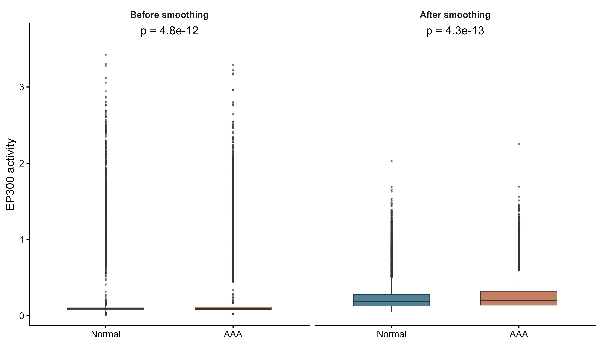

# TFRegAct

TFRegAct is an R package for Bayesian inference of transcription-factor (TF)
regulation and expression-anchored TF activity from bulk or single-cell RNA-seq data.
Bulk observations are samples; single-cell analyses use a selected cell population.

The package provides four main steps:

1. Build a confidence-weighted human TF--gene regulatory network from multiple
   evidence sources.
2. Construct a shared `TFComputationInput` object from a Seurat object and the
   target TF (and, for edge-level inference, target gene).
3. Estimate the direction and strength of one TF-to-gene regulatory edge using
   adjustment-set selection and two-stage negative-binomial Stan models.
4. Infer relative cell-level TF activity through target-gene selection,
   screening, MCMC refinement, and latent-activity estimation.

The regulatory FullMap is stored in the TFRegAct user cache rather than the
installed package directory. Build it once with:

```r
library(TFRegAct)
build_tf_network()
```

By default this uses `tools::R_user_dir("TFRegAct", "cache")`; the network
location can be overridden with `options(TFRegAct.network_path = "<path>")`.

## Basic usage: TF-to-gene regulatory direction

Subset the Seurat object to the cell population of interest before creating the
input object. The example below estimates the direction and effect size of one
TF-to-gene edge. Supply `batch_column` only when batch information is present;
otherwise leave it as `NULL`. Condition is also optional for regulatory-edge
inference: set `condition_column = NULL` when it is unavailable or should not
be adjusted for. Internally, available condition and batch variables are
encoded in a nuisance design matrix. Declare `data_type` explicitly as
`"single_cell"` (the default) or `"bulk"`. For single-cell data with condition,
also supply `sample_column`, identifying independent biological samples,
not condition labels or sequencing batches.

Regulatory Stage 2 is selected automatically:

| Data type | Condition | Stage 2 |
|---|---|---|
| Single-cell | Present | Hierarchical sample intercepts and focal-TF slopes, including a condition slope difference |
| Bulk | Present | Original model selected by `stage2_model` |
| Either | Absent (`condition_column = NULL`) | Original model without a condition interaction |

Stage 1 remains unchanged. `stage2_model` controls the bulk branch only when
condition is present; it does not override the conditioned single-cell route.
See [the hierarchical algorithm](docs/regulatory_hierarchical.md) for the model,
input checks and interpretation. Recreate previously serialized input objects
with the new constructor so that their type and biological-sample column are explicit.

```r
library(TFRegAct)

edge_input <- create_TF_computation_input(
  seurat_obj = macrophages,
  target_tf = "ATF4",
  target_gene = "ATF3",
  data_type = "single_cell",
  sample_column = "orig.ident", # biological sample, not condition or batch
  condition_column = "sample",
  control_level = "Normal",
  disease_level = "AAA"
)

edge_fit <- TF_regulatory_direction_computation(
  input = edge_input,
  batch_column = "batch", # use NULL when no batch column exists
  output = TRUE
)

edge_fit$direction_summary
```

The conditioned single-cell model centers retained TF predictors within each
biological sample and estimates sample-specific intercepts and focal-TF slopes.
It keeps the original Stage 1 and reuses its confidence-weighted directional
Laplace coefficient priors in Stage 2. Stage 1 posterior summaries are used for
screening and initialization, not to construct new priors. Each condition must
have at least two biological samples with within-sample focal-TF variation. Missing sample IDs, samples
spanning conditions, and a rank-deficient condition/batch design are rejected.

Inspect the selected route, sample map, and condition-specific estimates with:

```r
edge_fit$stage2_model
edge_fit$stage2_fit$sample_map
edge_fit$stage2_fit$fit$summary(c(
  "beta_target_control", "beta_target_disease", "beta_target_delta"
))
edge_fit$stage2_fit$fit$diagnostic_summary()
```

`beta_target_delta` is the disease-minus-control slope difference. The main
direction summary uses the midpoint coefficient across the two conditions;
it does not by itself establish a difference between conditions.

### Bulk input

Arrange raw counts, normalized TF predictors and sample metadata in a Seurat
container with one column per bulk sample. The response uses raw counts; the
normalized layer supplies TF predictors. Set `data_type = "bulk"` explicitly:

```r
bulk_input <- create_TF_computation_input(
  seurat_obj = bulk_samples,
  target_tf = "ATF4", target_gene = "ATF3",
  data_type = "bulk",
  condition_column = "condition",
  control_level = "control", disease_level = "disease"
)
bulk_fit <- TF_regulatory_direction_computation(
  input = bulk_input,
  stage2_model = "target_interaction", # or "no_interaction" (default)
  batch_column = NULL
)
```

### Input without condition

For either data type, `condition_column = NULL` selects the original Stage 2
without a condition interaction. Biological-sample IDs are not required for
this route. For example:

```r
unconditioned_input <- create_TF_computation_input(
  seurat_obj = macrophages,
  target_tf = "ATF4", target_gene = "ATF3",
  data_type = "single_cell", condition_column = NULL
)
unconditioned_fit <- TF_regulatory_direction_computation(
  input = unconditioned_input, batch_column = "batch"
)
```

When supplying an input object, its `data_type` and `sample_column` determine
routing. If repeated in the workflow call, their values must agree with the
object. Restart R after updating the package and recreate older input objects
with the new constructor. This routing change applies to regulatory-direction
inference; the activity/EM workflow retains its existing models.

### Validation

An earlier version with posterior-informed Normal Stage 2 priors was tested on
4,000 macrophages from 10 biological samples and two batches for EP300 to MTOR,
with batch adjustment.
Both stages used four MCMC chains, each with 400 warmup and 600 sampling
iterations. Neither stage had divergent transitions or maximum-tree-depth
hits; the largest R-hat among the checked parameters was 1.0059.
Stage 1 removed all five adjustment TFs in that run, so a separate synthetic
two-predictor fit checked the hierarchical model with retained covariates.
These are historical execution and sampler checks, not evidence of biological
accuracy or validation of the current directional-Laplace Stage 2 model. The
current model requires its own sampler diagnostics.

For the current knowledge-prior implementation,
`dev/validate_stage2_knowledge_prior.R` runs a reproducible synthetic check with
96 observations from eight biological samples and two retained TF predictors.
Stage 1 and the non-interaction, interaction and hierarchical Stage 2 routes
each used two chains with 300 warmup and 500 sampling iterations, and retained
identical nondefault knowledge-prior parameters. All chains completed with no
divergent transitions or maximum-tree-depth hits. The largest checked R-hat
was 1.0134 in the hierarchical fit; this small execution check does not establish
full convergence or biological accuracy.

`tests/regulatory-routing.R` checks all eight combinations of data type,
condition availability and legacy Stage 2 choice, together with metadata
alignment, biological-replicate guards and propagation of the original network
prior. It uses model substitutes for the dispatch checks and does not require
MCMC or private data.

`tests/stage2-knowledge-prior.R`, `tests/activity-knowledge-prior.R` and
`tests/stage3-knowledge-prior.R` check predictor alignment, posterior-independent
prior parameters, the Stage 2/3 handoff, deprecated options, cache invalidation,
and asymmetric-Laplace EM optimization including beta = 0.

## Basic usage: cell-level TF activity

For activity inference, omit `target_gene`. The function identifies direct
targets, finds target-specific adjustment sets, performs screening and MCMC
refinement, then returns a Seurat object containing `<TF>_activity_A`.
By default, direct target edges and prior-network edges must have confidence
at least 4. Both workflows use an exact minimum-vertex-cut solver on the
moralized ancestor subgraph of the back-door graph. The selected set has the
fewest nodes under the current DAG and the package's Pearl back-door constraint
(no adjustment for descendants of the target TF). This does not establish that
the supplied DAG is biologically correct. One representative minimum set is
returned; path confidence is reported but is not optimized among equal-size
solutions. All selected adjustment variables are retained in regression metrics,
including necessary variables without a directed path to the target gene;
their target-gene direction is unknown and confidence falls back to a directed
path towards the target TF. The original confidence filtering and DAG projection are
unchanged. Legacy restart/search-limit arguments do not affect the exact solver;
activity queries still parallelize across target genes using `cores`.
Old recursive-search caches are invalidated automatically.
The activity prescreen and regulatory Stage 1 share the same directional
Laplace Stan model and the same fitting function. Condition and batch terms are
optional and are encoded in one nuisance design matrix. Activity uses mean-field
variational inference by default. Set `prescreen_inference = "mcmc"` for Stage 1
screening with the same number of chains as Stage 2 and 200 warmup and 200
sampling iterations per chain by default. Regulatory-edge Stage 1 uses MCMC by
default and also supports mean-field or full-rank variational inference.
The subsequent activity MCMC and
non-hierarchical regulatory Stage 2 call the same negative-binomial Stan model
and MCMC fitting function. Conditioned single-cell regulatory Stage 2 instead
uses the sample hierarchy. In both workflows, Stage 2 retains the original
Stage 1 coefficient prior: the same confidence, direction, base scale,
confidence exponent and opposing-direction penalty define a zero-mode
directional Laplace distribution. Stage 1 posterior summaries support screening
and initialize the refit; they do not define Stage 2 priors. Stage 2 refits the
retained model using the original prior and the expression likelihood.
Stage 3 retains this directional Laplace prior for focal-TF coefficients.
Its default Rcpp Gibbs sampler uses adaptive rejection sampling (ARS) for
coefficients and positive activity. Interaction and
nuisance-parameter priors are unchanged. The former prior-transfer arguments
`direction_effect`, `beta_sd_floor`, and `stage1_sd_multiplier` are deprecated,
default to `NULL`, and non-`NULL` values are ignored with a warning.
Do not reuse Stage 2 or Stage 3 fits or checkpoints from the former Normal-prior
workflow; refit them under the current prior (use `force_refit = TRUE` for an
existing activity output directory). Set `condition_column = NULL` to
run the entire activity pipeline without condition effects or TF-by-condition
interactions; Stage 3 then reports overall cell activity and omits the
control-versus-disease contrast tables.

Stage 3 uses a soft spike-and-slab activity gate. When the normalized target-TF
expression is zero, the prior probability that the TF is active is controlled
by `active_prior_zero` (default `0.2`); when expression is detected, this prior
probability is fixed at `0.9`. Downstream target-gene evidence then updates the
cell-specific activity probability. Thus, zero expression strongly downweights
activity but does not force activity to zero. The inference workflow returns
unsmoothed activity; optional score smoothing is described below.

With `em_algorithm = "gibbs_ars"` (the default), Stage 3 jointly samples beta,
the activity gate, and positive activity. The auxiliary positive activity is
drawn from its RNA-anchored truncated Normal prior when the gate is inactive;
actual activity is zero in that state. Each sweep also proposes a reciprocal
scale move that increases coefficients while decreasing centered activity,
or the reverse. Its Metropolis-Hastings test includes the full posterior and
transformation Jacobian. The warmup and retained sweep counts are controlled
by `em_iter_warmup` and `em_iter_sampling`, both defaulting to 500 per fit. These are
posterior sampling sweeps rather than optimizer iterations. Completion alone
does not establish convergence; sampler diagnostics include effective sample
sizes and the scale-move acceptance rate.

Stage 3 defaults to a single fit with the baseline log mean (`eta0`) and
dispersion (`phi`) fixed at their Stage 2 posterior means. A positive
`nuisance_draw_count` selects joint nuisance-parameter draws without
replacement from the retained Stage 2 posterior. Workers divide those fits,
and the cell-level score averages their conditional posterior activity means.

Set `em_algorithm = "quadrature_em"` to explicitly use the previous integration
and conditional-MAP EM algorithm. Its sign-constrained M-step compares the
positive and negative beta half-axes with zero. Local curvature intervals are
missing at the Laplace prior kink. The `max_iter` control applies to this
algorithm, and the two `em_iter_*` sampling counts apply to `gibbs_ars`.

Stage 2 distributes genes across `cores` worker processes. Each worker handles
one gene at a time and runs three chains concurrently by default. Thus
`cores = 4` permits up to 12 concurrent chains. The number of concurrent chains
per gene can be reduced with `mcmc_parallel_chains`; the total chain count is
`mcmc_chains`. All requested chains and draws must complete before a gene fit
is accepted. No target-gene count cap is applied by the main activity function.

If Stage 1 retains no target-gene models, the main function retries the target
screen once at an 80% posterior interval. The usual requested interval is 90%,
so this is a reduction of ten percentage points. Exact intervals are computed
from the full target-coefficient posterior draws. The confounder threshold
stays unchanged. Existing support prevents fallback; failed or malformed fits
are never rescued. A second empty result stops the pipeline with an audit
table. The fallback is disabled by default when the initial interval is 80%
or lower, and can be disabled explicitly with
`prescreen_fallback_target_interval = NULL`.

Stage 2 has the same optional rule via `mcmc_fallback_target_interval = 0.80`,
which is disabled by default. Filtered RDS objects, gene summary CSV files and
the pipeline's `screening_audit` record requested and effective intervals,
whether fallback was attempted, and the initial/final target counts. New fit
summaries retain full target marginals even when only one nuisance draw is
kept. A legacy VI cache without those marginals requires `force_refit = TRUE`
if fallback is needed; complete legacy MCMC draws can be reused for rescreening.

```r
activity_input <- create_TF_computation_input(
  seurat_obj = macrophages,
  target_tf = "IRF7",
  condition_column = "sample",
  control_level = "Normal",
  disease_level = "AAA"
)

activity_fit <- TF_activity_computation(
  input = activity_input,
  batch_column = "batch", # use NULL when no batch column exists
  active_prior_zero = 0.2, # soft activity prior when TF expression is zero
  cores = 4,
  output = TRUE
)

activity_seurat <- activity_fit$seurat_object
head(activity_fit$pipeline_result$em_fit$activity_summary)
```

Arguments omitted from the examples use the defaults below. In most analyses,
users only need to set the input data, TF/gene, condition and batch columns,
confidence thresholds, and output behaviour. Prior, sampling, and numerical
defaults should normally be changed only for a planned sensitivity analysis or
when diagnostics indicate a problem.

## Complete arguments: regulatory-direction inference

`TF_regulatory_direction_computation()` accepts the following arguments.

### Input, subsetting, and output

| Argument | Default | Description |
|---|---:|---|
| `target_tf` | `NULL` | Target TF symbol. It may instead be supplied through `input`. |
| `target_gene` | `NULL` | Target gene symbol. It may instead be supplied through `input`. |
| `input` | `NULL` | A `TFComputationInput` object. Do not also supply `seurat_obj` or `data_file`. |
| `data_type` | `"single_cell"` | `"single_cell"` or `"bulk"`; normally stored in the input object. |
| `sample_column` | `NULL` | Biological-sample ID column, required for conditioned single-cell regulation; normally stored in the input object. |
| `seurat_obj` | `NULL` | In-memory Seurat object when `input` is not used. |
| `data_file` | `NULL` | `.RData` file containing an object named `pbmc`; alternative to `seurat_obj`. |
| `output` | `FALSE` | `FALSE` returns results in memory, `TRUE` creates `<TF>_<gene>_output`, and a character value specifies a directory. |
| `cell_column` | `NULL` | Metadata column used for cell-population subsetting. |
| `cell_levels` | `NULL` | Values retained from `cell_column`; `NULL` keeps all cells. |
| `batch_subset` | `NULL` | Optional batch values to retain before fitting. |
| `batch_column` | `NULL` | Batch metadata column; `NULL` fits without batch terms. |
| `condition_column` | `"sample"` | Two-level condition column; set to `NULL` for condition-free inference. |
| `control_level` | `"Normal"` | Reference condition label. |
| `disease_level` | `"AAA"` | Comparison condition label. |
| `assay` | `"RNA"` | Seurat assay used for expression extraction. |
| `layer` | `"data"` | Seurat normalized-expression layer. |
| `Y_exp` | `NULL` | Optional pre-extracted target-gene response; normally inferred from the Seurat object. |
| `libsize` | `NULL` | Optional precomputed library-size vector; normally extracted from counts. |

### Network, priors, and adjustment-set search

| Argument | Default | Description |
|---|---:|---|
| `network_edge_file` | package cache | FullMap regulatory-network file; normally left unchanged. |
| `confounder_confidence_threshold` | `3` | Minimum network confidence for candidate confounder edges. |
| `adjustment_search_starts` | `1` | Compatibility argument; ignored. Exact minimum-cut search runs once per query, without random restarts. |
| `adjustment_search_cores` | `4` | Compatibility argument for single-query search; the minimum-cut solver uses one core. |
| `max_adjustment_sets` | `NULL` | Deprecated compatibility argument; ignored by minimum-cut search. |
| `dagitty_beta` | `2` | Relative weight given to confidence on paths towards the target gene when adjustment sets are scored. |
| `gamma` | `1` | Base beta-prior scale used by both stages. This is the regulatory-interface counterpart of activity `beta_prior_scale`. |
| `eta` | `0.5` | Exponent controlling how strongly confidence changes the beta-prior scale in both stages. |
| `r_dir` | `3` | Additional shrinkage ratio on effects opposing the network direction in both stages. |
| `nuisance_prior_scale` | `1` | Normal-prior scale for available condition and batch columns in the nuisance design matrix. A scalar or one value per column is accepted. |
| `confidence_min` | `1` | Lower bound applied to network confidence. |
| `confidence_max` | `10` | Upper bound applied to network confidence. |

### Stage 1, filtering, and Stage 2

| Argument | Default | Description |
|---|---:|---|
| `stage1_inference` | `"mcmc"` | Stage 1 inference method: `"mcmc"` (default) or approximate `"variational"`. |
| `stage1_chains` | `3` | Stage 1 MCMC chains. |
| `stage1_iter_warmup` | `600` | Warmup iterations per Stage 1 chain. |
| `stage1_iter_sampling` | `1200` | Retained iterations per Stage 1 chain. |
| `stage1_adapt_delta` | `0.95` | Stage 1 HMC target acceptance probability. |
| `stage1_max_treedepth` | `12` | Stage 1 maximum HMC tree depth. |
| `stage1_variational_algorithm` | `"meanfield"` | Variational family used when `stage1_inference = "variational"`; use `"meanfield"` or `"fullrank"`. |
| `stage1_variational_iter` | `10000` | Maximum Stage 1 variational optimization iterations. |
| `stage1_variational_output_samples` | `2000` | Draws sampled from the fitted Stage 1 variational approximation. |
| `stage1_filter_interval` | `c(5, 95)` | Posterior percentile interval used to retain TF coefficients; the default is a central 90% interval. |
| `correlation_filter` | `TRUE` | Remove redundant, direction-consistent highly correlated TF predictors. |
| `correlation_threshold` | `0.7` | Absolute correlation threshold used by the redundancy filter. |
| `stage2_model` | `"no_interaction"` | Bulk with condition: `"no_interaction"` or `"target_interaction"`. Conditioned single-cell data automatically use the hierarchy; absent condition forces the original no-interaction model. |
| `sample_intercept_sd_scale` | `1` | Half-Normal scale for sample-intercept heterogeneity in hierarchical Stage 2. |
| `sample_slope_sd_scale` | `1` | Half-Normal scale for sample focal-TF slope heterogeneity in hierarchical Stage 2. |
| `direction_effect` | `NULL` | Deprecated compatibility argument; non-`NULL` values are ignored with a warning. |
| `beta_sd_floor` | `NULL` | Deprecated compatibility argument; non-`NULL` values are ignored with a warning. |
| `stage1_sd_multiplier` | `NULL` | Deprecated compatibility argument; non-`NULL` values are ignored with a warning. |
| `target_interaction_sd` | `0.5` | Prior SD for the target-TF-by-condition interaction. |
| `stage2_chains` | `3` | Stage 2 MCMC chains. |
| `stage2_iter_warmup` | `500` | Warmup iterations per Stage 2 chain. |
| `stage2_iter_sampling` | `900` | Retained iterations per Stage 2 chain. |
| `stage2_adapt_delta` | `0.95` | Stage 2 HMC target acceptance probability. |
| `stage2_max_treedepth` | `12` | Stage 2 maximum HMC tree depth. |
| `compute_loo` | `FALSE` | Compute LOO from the generated pointwise log likelihood. |
| `seed` | `123` | Random seed. |
| `refresh` | `50` | CmdStan progress-printing interval. |
| `force_recompile` | `FALSE` | Recompile the Stan model even when a compiled executable is available. |

## Complete arguments: cell-level activity inference

`TF_activity_computation()` accepts the following arguments.

### Input, subsetting, and output

| Argument | Default | Description |
|---|---:|---|
| `target_tf` | `NULL` | Target TF symbol; it may instead be supplied through `input`. |
| `input` | `NULL` | A `TFComputationInput` without a target gene. Do not also supply `seurat_obj` or `data_file`. |
| `seurat_obj` | `NULL` | In-memory Seurat object when `input` is not used. |
| `data_file` | `NULL` | `.RData` file containing an object named `pbmc`; alternative to `seurat_obj`. |
| `output` | `FALSE` | `FALSE` returns results in memory, `TRUE` creates `<TF>_output`, and a character value specifies a directory. |
| `cell_column` | `NULL` | Metadata column used for cell-population subsetting. |
| `cell_levels` | `NULL` | Values retained from `cell_column`; `NULL` keeps all cells. |
| `batch_subset` | `NULL` | Optional batch values to retain before fitting. |
| `batch_column` | `NULL` | Batch metadata column; `NULL` fits without batch terms. |
| `condition_column` | `"sample"` | Two-level condition column; set to `NULL` for condition-free inference. |
| `control_level` | `"Normal"` | Reference condition label. |
| `disease_level` | `"AAA"` | Comparison condition label. |
| `assay` | `"RNA"` | Seurat assay used for expression extraction. |
| `layer` | `"data"` | Seurat normalized-expression layer. |
| `cell_limit` | `NULL` | Optional maximum cell count for pilot analyses; `NULL` uses every selected cell. |
| `cell_limit_seed` | `123` | Seed used only when cells are subsampled by `cell_limit`. |

### Network, priors, and Stage 1 prescreen

| Argument | Default | Description |
|---|---:|---|
| `cores` | `4` | Gene workers, each processing one gene at a time; Stage 2 runs up to `mcmc_parallel_chains` chains per worker. Also used for Stage 3 nuisance-component parallelism. |
| `seed` | `123` | Main pipeline random seed. |
| `network_edge_file` | package cache | FullMap regulatory-network file; normally left unchanged. |
| `target_confidence_threshold` | `4` | Minimum confidence for direct target-TF-to-gene edges entering activity inference. |
| `target_confidence_override` | `NULL` | Optional named values or data frame replacing selected target-edge confidence values. |
| `confounder_confidence_threshold` | `4` | Minimum network confidence for candidate confounder edges. |
| `adjustment_search_starts` | `1` | Compatibility argument; ignored. Exact minimum-cut search runs once per target gene. Activity `cores` still parallelizes different target genes. |
| `max_adjustment_sets` | `NULL` | Deprecated compatibility argument; ignored by minimum-cut search. |
| `dagitty_beta` | `2` | Relative weight given to confidence on paths towards each target gene. |
| `beta_prior_scale` | `1` | Base directional-Laplace beta-prior scale shared by all three stages. |
| `eta` | `0.5` | Exponent controlling how strongly confidence changes the beta-prior scale in all three stages. |
| `r_dir` | `3` | Additional shrinkage ratio on effects opposing the network direction in all three stages. |
| `batch_prior_scale` | `1` | Normal-prior scale for batch contrasts. |
| `target_interaction_sd` | `0.5` | Prior SD for the target-TF-by-condition interaction. |
| `predictor_sd_min` | `1e-8` | Predictors with an SD at or below this value are treated as non-informative. |
| `standardize_predictors` | `TRUE` | Standardize TF predictors before regression. |
| `prescreen_target_interval` | `0.90` | Stage 1 interval used to retain target-gene models supported in at least one condition. |
| `prescreen_fallback_target_interval` | `0.80` | One-time target-only fallback if Stage 1 is empty; disabled when the initial interval is 80% or lower. Set `NULL` to disable. |
| `prescreen_confounder_interval` | `0.90` | Stage 1 interval used to remove unsupported confounder TFs. |
| `prescreen_inference` | `"variational"` | Use mean-field ADVI or set `"mcmc"` for Stage 1 sampling. |
| `prescreen_mcmc_iter_warmup` | `200` | Warmup iterations per Stage 1 MCMC chain. |
| `prescreen_mcmc_iter_sampling` | `200` | Retained iterations per Stage 1 MCMC chain. |
| `prescreen_variational_iter` | `10000` | Maximum mean-field variational iterations per target gene. |
| `prescreen_output_samples` | `2000` | Variational posterior draws used for interval screening. |

### Stage 2 MCMC and Stage 3 activity

| Argument | Default | Description |
|---|---:|---|
| `direction_effect` | `NULL` | Deprecated compatibility argument; non-`NULL` values are ignored with a warning. |
| `beta_sd_floor` | `NULL` | Deprecated compatibility argument; non-`NULL` values are ignored with a warning. |
| `stage1_sd_multiplier` | `NULL` | Deprecated compatibility argument; non-`NULL` values are ignored with a warning. |
| `stage2_alpha_prior_sd` | `1` | Stage 2 intercept-prior SD. |
| `mcmc_target_interval` | `0.90` | Stage 2 interval used to retain target-gene models. |
| `mcmc_fallback_target_interval` | `NULL` | Optional one-time fallback if Stage 2 is empty; set `0.80` to enable an 80% target interval. |
| `mcmc_confounder_interval` | `0.90` | Interval level recorded for confounder summaries. Stage 2 does not remove confounders. |
| `mcmc_chains` | `3` | Chains per gene in Stage 2 and in Stage 1 when using MCMC. |
| `mcmc_parallel_chains` | `mcmc_chains` | Concurrent chains per gene worker; three by default. |
| `mcmc_iter_warmup` | `500` | Warmup iterations per Stage 2 chain. |
| `mcmc_iter_sampling` | `500` | Retained iterations per Stage 2 chain. |
| `mcmc_adapt_delta` | `0.95` | Stage 2 HMC target acceptance probability. |
| `mcmc_max_treedepth` | `12` | Stage 2 maximum HMC tree depth. |
| `em_algorithm` | `"gibbs_ars"` | Joint coefficient/activity posterior sampling; `"quadrature_em"` selects legacy conditional-MAP EM. |
| `em_iter_warmup` | `500` | Discarded Stage 3 sweeps per nuisance component under `gibbs_ars`. |
| `em_iter_sampling` | `500` | Retained Stage 3 sweeps per nuisance component under `gibbs_ars`. |
| `nuisance_draw_count` | `0` | Use Stage 2 nuisance posterior means in one fit. A positive count selects joint Stage 2 draws without replacement, with one fit per draw. |
| `active_prior_zero` | `0.2` | Prior active probability for a cell whose normalized target-TF expression is zero. The corresponding prior zero-activity probability is `0.8`. |
| `em_control` | `list()` | Optional named list of advanced Stage 3 numerical controls described below. |
| `resume` | `TRUE` | Resume compatible pipeline checkpoints. |
| `force_refit` | `FALSE` | Refit completed stages rather than reusing compatible results. |
| `force_recompile` | `FALSE` | Recompile Stan models even when compatible executables exist. |

The active prior for cells with detected target-TF expression is fixed at
`0.9`; it is intentionally not a second user parameter. Consequently, only
one gate probability needs to be specified. The following advanced Stage 3
settings can be supplied through `em_control`. Integration, optimization and
EM convergence controls in the table apply only to `quadrature_em`.
The main arguments `em_algorithm`, `em_iter_warmup`, and `em_iter_sampling`
cannot be overridden through `em_control`.

| `em_control` entry | Default | Description |
|---|---:|---|
| `kappa` | `1` | Multiplier relating the positive-activity slab SD to the target-TF expression scale. |
| `expression_zero_tolerance` | `0` | Expression values at or below this threshold are treated as zero. |
| `scale_move_sd` | `0.1` | SD of the symmetric log-scale proposal for the reciprocal coefficient/activity move under `gibbs_ars`. |
| `quadrature_nodes` | `21` | Gauss-Legendre nodes used for each cell-specific positive-activity integral. |
| `max_iter` | `30` | Maximum EM iterations. |
| `min_iter` | `2` | Minimum EM iterations before convergence is allowed. |
| `beta_tolerance` | `1e-3` | Convergence tolerance for target beta updates. |
| `activity_tolerance` | `1e-3` | Convergence tolerance for cell-activity updates. |
| `objective_tolerance` | `1e-8` | Convergence tolerance for objective changes. |
| `monotonicity_tolerance` | `1e-4` | Permitted numerical deviation from monotone EM improvement. |
| `tail_log_drop` | `30` | Required log-density drop when truncating the positive-activity integration tail. |
| `max_upper_expansions` | `12` | Maximum expansions used to locate the integration upper bound. |
| `mstep_maxit` | `100` | Maximum optimizer iterations for each sign-constrained M-step optimization. |
| `mstep_reltol` | `1e-8` | Relative optimizer tolerance for sign-constrained M-step optimization. |
| `checkpoint_every` | `NULL` | Optional checkpoint frequency across nuisance draws. |
| `save_traces` | `TRUE` in the pipeline | Retain sampling or EM iteration traces for diagnostics. |

For example, the biologically important activity-gate and slab-width settings
can be changed without specifying all other defaults:

```r
activity_fit <- TF_activity_computation(
  input = activity_input,
  active_prior_zero = 0.2,
  em_control = list(kappa = 1),
  output = TRUE
)
```

## Optional smoothing and visualization

After activity inference, optionally smooth scores and plot the result.
The figures below were generated with the earlier posterior-informed Normal
Stage 2 model and are retained as plotting examples. Regenerate activity under
the current directional-Laplace model before using them as current results.

<!-- smoothing-example:start -->
```r
library(TFRegAct)
library(Seurat)
library(ggplot2)

obj <- activity_fit$seurat_object
coordinate <- Embeddings(obj, "integrated.cca")
obj$EP300_activity_smooth <- smooth_TF_activity(
  score = setNames(obj$EP300_activity_A, colnames(obj)),
  coordinate = coordinate, umi = obj$nCount_RNA, batch = obj$batch, k = 15
)
```

Without batch labels, use `Embeddings(obj, "umap")` and `batch = NULL`.
Coordinates must have cell row names and matching reduction dimension names.

### UMAP feature plot

```r
md <- obj[[]]
umap <- Embeddings(obj, "umap")[rownames(md), 1:2, drop = FALSE]
panel_order <- c("Before smoothing", "After smoothing")
feature_data <- data.frame(
  UMAP_1 = rep(umap[, 1], 2), UMAP_2 = rep(umap[, 2], 2),
  Activity = c(md$EP300_activity_A, md$EP300_activity_smooth),
  smoothing = factor(rep(panel_order, each = nrow(md)), levels = panel_order)
)
feature_data <- feature_data[order(feature_data$Activity), ]
p_feature <- ggplot(feature_data, aes(UMAP_1, UMAP_2, colour = Activity)) +
  geom_point(size = 0.4) +
  facet_wrap(~ smoothing, nrow = 1) +
  coord_equal() +
  scale_colour_gradient(low = "lightgrey", high = "firebrick",
                        limits = c(0, max(feature_data$Activity))) +
  labs(x = "UMAP 1", y = "UMAP 2", colour = "EP300\nactivity") +
  theme_classic() +
  theme(strip.background = element_blank(), strip.text = element_text(face = "bold"))
p_feature
```


### Boxplots before and after smoothing

```r
md <- obj[[]]
panel_order <- c("Before smoothing", "After smoothing")
box_data <- data.frame(
  sample = factor(rep(md$sample, 2), levels = c("Normal", "AAA")),
  Activity = c(md$EP300_activity_A, md$EP300_activity_smooth),
  smoothing = factor(rep(panel_order, each = nrow(md)), levels = panel_order)
)
tests <- lapply(split(box_data, box_data$smoothing),
                function(d) t.test(Activity ~ sample, data = d))
test_labels <- data.frame(
  smoothing = factor(names(tests), levels = panel_order),
  label = sprintf("p = %.2g", vapply(tests, function(test) test$p.value, numeric(1)))
)
p_box <- ggplot(box_data, aes(sample, Activity, fill = sample)) +
  geom_boxplot(width = 0.6, linewidth = 0.25, outlier.size = 0.3, outlier.alpha = 0.55) +
  facet_wrap(~ smoothing, nrow = 1) +
  geom_text(data = test_labels, aes(x = 1.5, y = Inf, label = label),
            inherit.aes = FALSE, vjust = 1.35) +
  scale_fill_manual(values = c(Normal = "#4D8299", AAA = "#C47F62")) +
  scale_y_continuous(expand = expansion(mult = c(0.04, 0.12))) +
  labs(x = NULL, y = "EP300 activity") + theme_classic() +
  theme(legend.position = "none", strip.background = element_blank(),
        strip.text = element_text(face = "bold"))
p_box
```
<!-- smoothing-example:end -->

The left boxplot uses the original EP300 activity scores. The right boxplot uses the KNN-smoothed scores for the same cells. Both panels share the same y-axis.



Example: **14,627 macrophages** (6,085 Normal; 8,542 AAA), 22 retained target genes,
`nuisance_draw_count = 0`. Cell-level Welch p-values are exploratory because cells
within a sample and smoothed scores are correlated. [Sample-level results](docs/figures/smoothing-ttests.csv).

[Figure scripts](dev/generate_smoothing_example.R) · [Cached boxplot script](dev/generate_ep300_cell_comparison.R) · [Source data](docs/figures/smoothing-source-data.csv)
