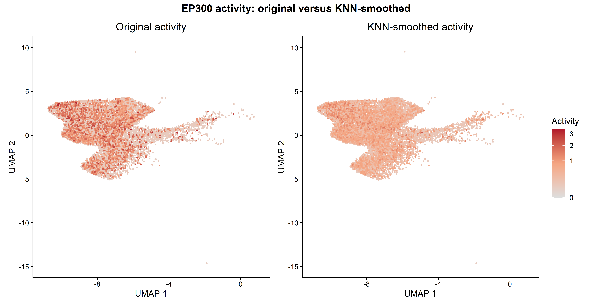
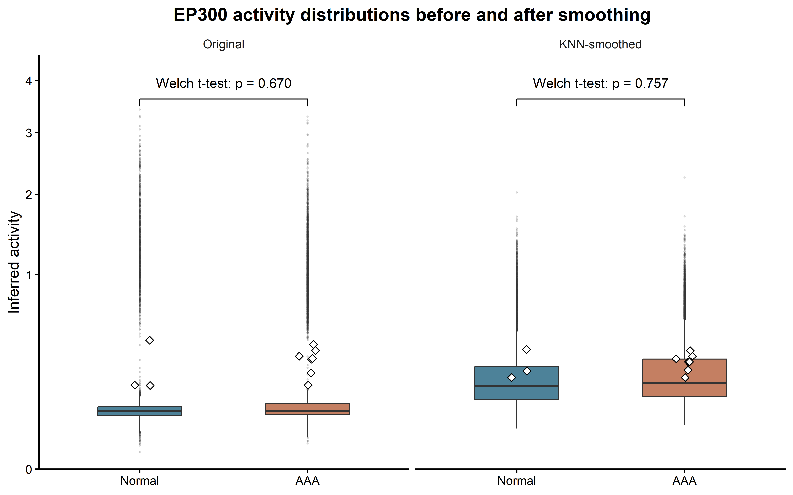
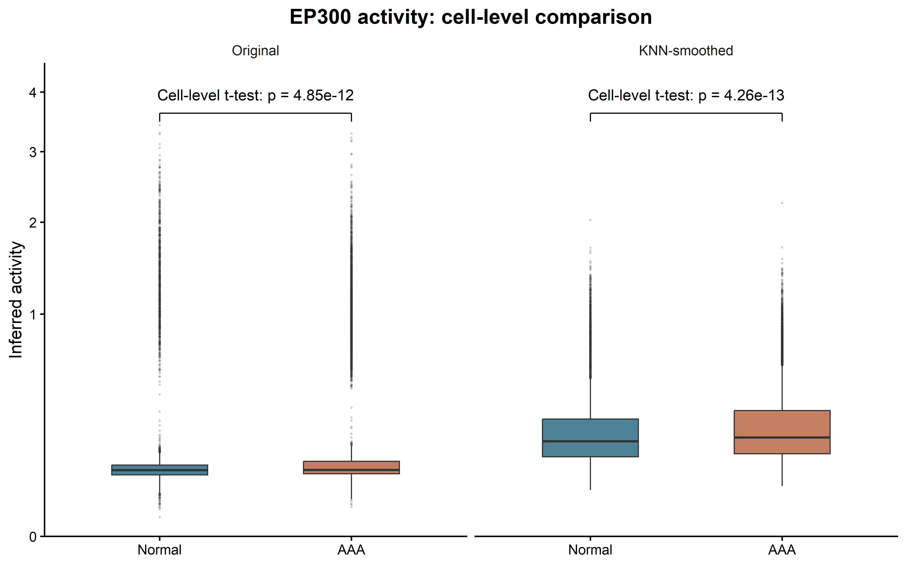

# TFRegAct

TFRegAct is an R package for Bayesian inference of transcription-factor (TF)
regulation and expression-anchored TF activity from bulk or single-cell RNA-seq data.
Bulk observations are samples; single-cell analyses use a selected cell population.

The package provides four main steps:

1. Build a confidence-weighted human TF--gene regulatory network from multiple
   evidence sources.
2. Construct a shared `TFComputationInput` object from a Seurat object and the
   target TF (and, for edge-level inference, target gene).
3. Estimate the direction and strength of one TF-to-gene regulatory edge using
   adjustment-set selection and two-stage negative-binomial Stan models.
4. Infer relative cell-level TF activity through target-gene selection,
   screening, MCMC refinement, and latent-activity estimation.

The regulatory FullMap is stored in the TFRegAct user cache rather than the
installed package directory. Build it once with:

```r
library(TFRegAct)
build_tf_network()
```

By default this uses `tools::R_user_dir("TFRegAct", "cache")`; the network
location can be overridden with `options(TFRegAct.network_path = "<path>")`.

## Basic usage: TF-to-gene regulatory direction

Subset the Seurat object to the cell population of interest before creating the
input object. The example below estimates the direction and effect size of one
TF-to-gene edge. Supply `batch_column` only when batch information is present;
otherwise leave it as `NULL`. Condition is also optional for regulatory-edge
inference: set `condition_column = NULL` when it is unavailable or should not
be adjusted for. Internally, available condition and batch variables are
encoded in a nuisance design matrix. Declare `data_type` explicitly as
`"single_cell"` (the default) or `"bulk"`. For single-cell data with condition,
also supply `sample_column`, identifying independent biological samples,
not condition labels or sequencing batches.

Regulatory Stage 2 is selected automatically:

| Data type | Condition | Stage 2 |
|---|---|---|
| Single-cell | Present | Hierarchical sample intercepts and focal-TF slopes, including a condition slope difference |
| Bulk | Present | Original model selected by `stage2_model` |
| Either | Absent (`condition_column = NULL`) | Original model without a condition interaction |

Stage 1 remains unchanged. `stage2_model` controls the bulk branch only when
condition is present; it does not override the conditioned single-cell route.
See [the hierarchical algorithm](docs/regulatory_hierarchical.md) for the model,
input checks and interpretation. Recreate previously serialized input objects
with the new constructor so that their type and biological-sample column are explicit.

```r
library(TFRegAct)

edge_input <- create_TF_computation_input(
  seurat_obj = macrophages,
  target_tf = "ATF4",
  target_gene = "ATF3",
  data_type = "single_cell",
  sample_column = "orig.ident", # biological sample, not condition or batch
  condition_column = "sample",
  control_level = "Normal",
  disease_level = "AAA"
)

edge_fit <- TF_regulatory_direction_computation(
  input = edge_input,
  batch_column = "batch", # use NULL when no batch column exists
  output = TRUE
)

edge_fit$direction_summary
```

The conditioned single-cell model centers retained TF predictors within each
biological sample and estimates sample-specific intercepts and focal-TF slopes.
It keeps the original Stage 1 and uses its posterior summaries to construct
the Stage 2 Normal priors. Each condition must have at least two biological
samples with within-sample focal-TF variation. Missing sample IDs, samples
spanning conditions, and a rank-deficient condition/batch design are rejected.

Inspect the selected route, sample map, and condition-specific estimates with:

```r
edge_fit$stage2_model
edge_fit$stage2_fit$sample_map
edge_fit$stage2_fit$fit$summary(c(
  "beta_target_control", "beta_target_disease", "beta_target_delta"
))
edge_fit$stage2_fit$fit$diagnostic_summary()
```

`beta_target_delta` is the disease-minus-control slope difference. The main
direction summary uses the midpoint coefficient across the two conditions;
it does not by itself establish a difference between conditions.

### Bulk input

Arrange raw counts, normalized TF predictors and sample metadata in a Seurat
container with one column per bulk sample. The response uses raw counts; the
normalized layer supplies TF predictors. Set `data_type = "bulk"` explicitly:

```r
bulk_input <- create_TF_computation_input(
  seurat_obj = bulk_samples,
  target_tf = "ATF4", target_gene = "ATF3",
  data_type = "bulk",
  condition_column = "condition",
  control_level = "control", disease_level = "disease"
)
bulk_fit <- TF_regulatory_direction_computation(
  input = bulk_input,
  stage2_model = "target_interaction", # or "no_interaction" (default)
  batch_column = NULL
)
```

### Input without condition

For either data type, `condition_column = NULL` selects the original Stage 2
without a condition interaction. Biological-sample IDs are not required for
this route. For example:

```r
unconditioned_input <- create_TF_computation_input(
  seurat_obj = macrophages,
  target_tf = "ATF4", target_gene = "ATF3",
  data_type = "single_cell", condition_column = NULL
)
unconditioned_fit <- TF_regulatory_direction_computation(
  input = unconditioned_input, batch_column = "batch"
)
```

When supplying an input object, its `data_type` and `sample_column` determine
routing. If repeated in the workflow call, their values must agree with the
object. Restart R after updating the package and recreate older input objects
with the new constructor. This routing change applies to regulatory-direction
inference; the activity/EM workflow retains its existing models.

### Validation

The complete regulatory workflow was tested on 4,000 macrophages from 10
biological samples and two batches for EP300 to MTOR, with batch adjustment.
Both stages used four MCMC chains, each with 400 warmup and 600 sampling
iterations. Neither stage had divergent transitions or maximum-tree-depth
hits; the largest R-hat among the checked parameters was 1.0059.
Stage 1 removed all five adjustment TFs in that run, so a separate synthetic
two-predictor fit checked the hierarchical model with retained covariates.
These are execution and sampler checks, not evidence of biological accuracy.

`tests/regulatory-routing.R` checks all eight combinations of data type,
condition availability and legacy Stage 2 choice, together with metadata
alignment, biological-replicate guards and prior transfer. It uses model
substitutes for the dispatch checks and does not require MCMC or private data.

## Basic usage: cell-level TF activity

For activity inference, omit `target_gene`. The function identifies direct
targets, finds target-specific adjustment sets, performs screening and MCMC
refinement, then returns a Seurat object containing `<TF>_activity_A`.
By default, direct target edges and prior-network edges must have confidence
at least 4. Both workflows use an exact minimum-vertex-cut solver on the
moralized ancestor subgraph of the back-door graph. The selected set has the
fewest nodes under the current DAG and the package's Pearl back-door constraint
(no adjustment for descendants of the target TF). This does not establish that
the supplied DAG is biologically correct. One representative minimum set is
returned; path confidence is reported but is not optimized among equal-size
solutions. All selected adjustment variables are retained in regression metrics,
including necessary variables without a directed path to the target gene;
their target-gene direction is unknown and confidence falls back to a directed
path towards the target TF. The original confidence filtering and DAG projection are
unchanged. Legacy restart/search-limit arguments do not affect the exact solver;
activity queries still parallelize across target genes using `cores`.
Old recursive-search caches are invalidated automatically.
The activity prescreen and regulatory Stage 1 share the same directional
Laplace Stan model and the same fitting function. Condition and batch terms are
optional and are encoded in one nuisance design matrix. Activity uses the
shared model with mean-field variational inference. Regulatory-edge Stage 1
uses MCMC by default, but can instead use mean-field or full-rank variational
inference for faster approximate screening. The subsequent activity Normal-prior MCMC and
non-hierarchical regulatory Stage 2 call the same negative-binomial Stan model
and MCMC fitting function. Conditioned single-cell regulatory Stage 2 instead
uses the sample hierarchy. In both workflows, the retained Stage 1 posterior is converted in R
to `beta_prior_mean` and `beta_prior_sd`; network confidence is not applied a
second time in Stage 2. This transfer is controlled by `direction_effect`,
`beta_sd_floor`, and `stage1_sd_multiplier`. Set `condition_column = NULL` to
run the entire activity pipeline without condition effects or TF-by-condition
interactions; Stage 3 then reports overall cell activity and omits the
control-versus-disease contrast tables.

Stage 3 uses a soft spike-and-slab activity gate. When the normalized target-TF
expression is zero, the prior probability that the TF is active is controlled
by `active_prior_zero` (default `0.2`); when expression is detected, this prior
probability is fixed at `0.9`. Downstream target-gene evidence then updates the
cell-specific activity probability. Thus, zero expression strongly downweights
activity but does not force activity to zero. The inference workflow returns
unsmoothed activity; optional score smoothing is described below.

```r
activity_input <- create_TF_computation_input(
  seurat_obj = macrophages,
  target_tf = "IRF7",
  condition_column = "sample",
  control_level = "Normal",
  disease_level = "AAA"
)

activity_fit <- TF_activity_computation(
  input = activity_input,
  batch_column = "batch", # use NULL when no batch column exists
  active_prior_zero = 0.2, # soft activity prior when TF expression is zero
  cores = 4,
  output = TRUE
)

activity_seurat <- activity_fit$seurat_object
head(activity_fit$pipeline_result$em_fit$activity_summary)
```

Arguments omitted from the examples use the defaults below. In most analyses,
users only need to set the input data, TF/gene, condition and batch columns,
confidence thresholds, and output behaviour. Prior, sampling, and numerical
defaults should normally be changed only for a planned sensitivity analysis or
when diagnostics indicate a problem.

## Complete arguments: regulatory-direction inference

`TF_regulatory_direction_computation()` accepts the following arguments.

### Input, subsetting, and output

| Argument | Default | Description |
|---|---:|---|
| `target_tf` | `NULL` | Target TF symbol. It may instead be supplied through `input`. |
| `target_gene` | `NULL` | Target gene symbol. It may instead be supplied through `input`. |
| `input` | `NULL` | A `TFComputationInput` object. Do not also supply `seurat_obj` or `data_file`. |
| `data_type` | `"single_cell"` | `"single_cell"` or `"bulk"`; normally stored in the input object. |
| `sample_column` | `NULL` | Biological-sample ID column, required for conditioned single-cell regulation; normally stored in the input object. |
| `seurat_obj` | `NULL` | In-memory Seurat object when `input` is not used. |
| `data_file` | `NULL` | `.RData` file containing an object named `pbmc`; alternative to `seurat_obj`. |
| `output` | `FALSE` | `FALSE` returns results in memory, `TRUE` creates `<TF>_<gene>_output`, and a character value specifies a directory. |
| `cell_column` | `NULL` | Metadata column used for cell-population subsetting. |
| `cell_levels` | `NULL` | Values retained from `cell_column`; `NULL` keeps all cells. |
| `batch_subset` | `NULL` | Optional batch values to retain before fitting. |
| `batch_column` | `NULL` | Batch metadata column; `NULL` fits without batch terms. |
| `condition_column` | `"sample"` | Two-level condition column; set to `NULL` for condition-free inference. |
| `control_level` | `"Normal"` | Reference condition label. |
| `disease_level` | `"AAA"` | Comparison condition label. |
| `assay` | `"RNA"` | Seurat assay used for expression extraction. |
| `layer` | `"data"` | Seurat normalized-expression layer. |
| `Y_exp` | `NULL` | Optional pre-extracted target-gene response; normally inferred from the Seurat object. |
| `libsize` | `NULL` | Optional precomputed library-size vector; normally extracted from counts. |

### Network, priors, and adjustment-set search

| Argument | Default | Description |
|---|---:|---|
| `network_edge_file` | package cache | FullMap regulatory-network file; normally left unchanged. |
| `confounder_confidence_threshold` | `3` | Minimum network confidence for candidate confounder edges. |
| `adjustment_search_starts` | `1` | Compatibility argument; ignored. Exact minimum-cut search runs once per query, without random restarts. |
| `adjustment_search_cores` | `4` | Compatibility argument for single-query search; the minimum-cut solver uses one core. |
| `max_adjustment_sets` | `NULL` | Deprecated compatibility argument; ignored by minimum-cut search. |
| `dagitty_beta` | `2` | Relative weight given to confidence on paths towards the target gene when adjustment sets are scored. |
| `gamma` | `1` | Base Stage 1 beta-prior scale. This is the regulatory-interface counterpart of activity `beta_prior_scale`. |
| `eta` | `0.5` | Exponent controlling how strongly confidence changes the beta-prior scale. |
| `r_dir` | `3` | Additional shrinkage ratio on effects opposing the network direction. |
| `nuisance_prior_scale` | `1` | Normal-prior scale for available condition and batch columns in the nuisance design matrix. A scalar or one value per column is accepted. |
| `confidence_min` | `1` | Lower bound applied to network confidence. |
| `confidence_max` | `10` | Upper bound applied to network confidence. |

### Stage 1, filtering, and Stage 2

| Argument | Default | Description |
|---|---:|---|
| `stage1_inference` | `"mcmc"` | Stage 1 inference method: `"mcmc"` (default) or approximate `"variational"`. |
| `stage1_chains` | `3` | Stage 1 MCMC chains. |
| `stage1_iter_warmup` | `600` | Warmup iterations per Stage 1 chain. |
| `stage1_iter_sampling` | `1200` | Retained iterations per Stage 1 chain. |
| `stage1_adapt_delta` | `0.95` | Stage 1 HMC target acceptance probability. |
| `stage1_max_treedepth` | `12` | Stage 1 maximum HMC tree depth. |
| `stage1_variational_algorithm` | `"meanfield"` | Variational family used when `stage1_inference = "variational"`; use `"meanfield"` or `"fullrank"`. |
| `stage1_variational_iter` | `10000` | Maximum Stage 1 variational optimization iterations. |
| `stage1_variational_output_samples` | `2000` | Draws sampled from the fitted Stage 1 variational approximation. |
| `stage1_filter_interval` | `c(5, 95)` | Posterior percentile interval used to retain TF coefficients; the default is a central 90% interval. |
| `correlation_filter` | `TRUE` | Remove redundant, direction-consistent highly correlated TF predictors. |
| `correlation_threshold` | `0.7` | Absolute correlation threshold used by the redundancy filter. |
| `stage2_model` | `"no_interaction"` | Bulk with condition: `"no_interaction"` or `"target_interaction"`. Conditioned single-cell data automatically use the hierarchy; absent condition forces the original no-interaction model. |
| `sample_intercept_sd_scale` | `1` | Half-Normal scale for sample-intercept heterogeneity in hierarchical Stage 2. |
| `sample_slope_sd_scale` | `1` | Half-Normal scale for sample focal-TF slope heterogeneity in hierarchical Stage 2. |
| `direction_effect` | `0.2` | Direction-dependent shift added to the Stage 1 beta mean when constructing the Stage 2 Normal prior. |
| `beta_sd_floor` | `0.5` | Minimum Stage 2 beta-prior standard deviation. |
| `stage1_sd_multiplier` | `1.5` | Multiplier applied to the Stage 1 beta posterior SD for the Stage 2 prior. |
| `target_interaction_sd` | `0.5` | Prior SD for the target-TF-by-condition interaction. |
| `stage2_chains` | `3` | Stage 2 MCMC chains. |
| `stage2_iter_warmup` | `500` | Warmup iterations per Stage 2 chain. |
| `stage2_iter_sampling` | `900` | Retained iterations per Stage 2 chain. |
| `stage2_adapt_delta` | `0.95` | Stage 2 HMC target acceptance probability. |
| `stage2_max_treedepth` | `12` | Stage 2 maximum HMC tree depth. |
| `compute_loo` | `FALSE` | Compute LOO from the generated pointwise log likelihood. |
| `seed` | `123` | Random seed. |
| `refresh` | `50` | CmdStan progress-printing interval. |
| `force_recompile` | `FALSE` | Recompile the Stan model even when a compiled executable is available. |

## Complete arguments: cell-level activity inference

`TF_activity_computation()` accepts the following arguments.

### Input, subsetting, and output

| Argument | Default | Description |
|---|---:|---|
| `target_tf` | `NULL` | Target TF symbol; it may instead be supplied through `input`. |
| `input` | `NULL` | A `TFComputationInput` without a target gene. Do not also supply `seurat_obj` or `data_file`. |
| `seurat_obj` | `NULL` | In-memory Seurat object when `input` is not used. |
| `data_file` | `NULL` | `.RData` file containing an object named `pbmc`; alternative to `seurat_obj`. |
| `output` | `FALSE` | `FALSE` returns results in memory, `TRUE` creates `<TF>_output`, and a character value specifies a directory. |
| `cell_column` | `NULL` | Metadata column used for cell-population subsetting. |
| `cell_levels` | `NULL` | Values retained from `cell_column`; `NULL` keeps all cells. |
| `batch_subset` | `NULL` | Optional batch values to retain before fitting. |
| `batch_column` | `NULL` | Batch metadata column; `NULL` fits without batch terms. |
| `condition_column` | `"sample"` | Two-level condition column; set to `NULL` for condition-free inference. |
| `control_level` | `"Normal"` | Reference condition label. |
| `disease_level` | `"AAA"` | Comparison condition label. |
| `assay` | `"RNA"` | Seurat assay used for expression extraction. |
| `layer` | `"data"` | Seurat normalized-expression layer. |
| `cell_limit` | `NULL` | Optional maximum cell count for pilot analyses; `NULL` uses every selected cell. |
| `cell_limit_seed` | `123` | Seed used only when cells are subsampled by `cell_limit`. |

### Network, priors, and Stage 1 prescreen

| Argument | Default | Description |
|---|---:|---|
| `cores` | `4` | Workers used for per-gene fitting and Stage 3 draw-level parallelism. |
| `seed` | `123` | Main pipeline random seed. |
| `network_edge_file` | package cache | FullMap regulatory-network file; normally left unchanged. |
| `target_confidence_threshold` | `4` | Minimum confidence for direct target-TF-to-gene edges entering activity inference. |
| `target_confidence_override` | `NULL` | Optional named values or data frame replacing selected target-edge confidence values. |
| `confounder_confidence_threshold` | `4` | Minimum network confidence for candidate confounder edges. |
| `adjustment_search_starts` | `1` | Compatibility argument; ignored. Exact minimum-cut search runs once per target gene. Activity `cores` still parallelizes different target genes. |
| `max_adjustment_sets` | `NULL` | Deprecated compatibility argument; ignored by minimum-cut search. |
| `dagitty_beta` | `2` | Relative weight given to confidence on paths towards each target gene. |
| `beta_prior_scale` | `1` | Base Stage 1 beta-prior scale. |
| `eta` | `0.5` | Exponent controlling how strongly confidence changes the beta-prior scale. |
| `r_dir` | `3` | Additional shrinkage ratio on effects opposing the network direction. |
| `batch_prior_scale` | `1` | Normal-prior scale for batch contrasts. |
| `target_interaction_sd` | `0.5` | Prior SD for the target-TF-by-condition interaction. |
| `predictor_sd_min` | `1e-8` | Predictors with an SD at or below this value are treated as non-informative. |
| `standardize_predictors` | `TRUE` | Standardize TF predictors before regression. |
| `prescreen_target_interval` | `0.90` | Stage 1 interval used to retain target-gene models supported in at least one condition. |
| `prescreen_confounder_interval` | `0.90` | Stage 1 interval used to remove unsupported confounder TFs. |
| `prescreen_variational_iter` | `10000` | Maximum mean-field variational iterations per target gene. |
| `prescreen_output_samples` | `2000` | Variational posterior draws used for interval screening. |

### Stage 2 MCMC and Stage 3 activity

| Argument | Default | Description |
|---|---:|---|
| `direction_effect` | `0.2` | Direction-dependent shift added to the Stage 1 beta mean for the Stage 2 prior. |
| `beta_sd_floor` | `0.5` | Minimum Stage 2 beta-prior standard deviation. |
| `stage1_sd_multiplier` | `1.5` | Multiplier applied to Stage 1 beta posterior SDs for Stage 2 priors. |
| `stage2_alpha_prior_sd` | `1` | Stage 2 intercept-prior SD. |
| `mcmc_target_interval` | `0.90` | Stage 2 interval used to retain target-gene models. |
| `mcmc_confounder_interval` | `0.90` | Interval level recorded for confounder summaries. Stage 2 does not remove confounders. |
| `mcmc_chains` | `3` | Stage 2 MCMC chains. |
| `mcmc_iter_warmup` | `400` | Warmup iterations per Stage 2 chain. |
| `mcmc_iter_sampling` | `600` | Retained iterations per Stage 2 chain. |
| `mcmc_adapt_delta` | `0.95` | Stage 2 HMC target acceptance probability. |
| `mcmc_max_treedepth` | `12` | Stage 2 maximum HMC tree depth. |
| `nuisance_draw_count` | `100` | Stage 3 hyperparameter: number of nuisance-parameter draws sampled without replacement from all Stage 2 posterior draws, with one conditional EM fit per draw; `0` uses posterior means in a single fit. |
| `active_prior_zero` | `0.2` | Prior active probability for a cell whose normalized target-TF expression is zero. The corresponding prior zero-activity probability is `0.8`. |
| `em_control` | `list()` | Optional named list of advanced Stage 3 numerical controls described below. |
| `resume` | `TRUE` | Resume compatible pipeline checkpoints. |
| `force_refit` | `FALSE` | Refit completed stages rather than reusing compatible results. |
| `force_recompile` | `FALSE` | Recompile Stan models even when compatible executables exist. |

The active prior for cells with detected target-TF expression is fixed at
`0.9`; it is intentionally not a second user parameter. Consequently, only
one gate probability needs to be specified. The following advanced Stage 3
settings can be supplied through `em_control`:

| `em_control` entry | Default | Description |
|---|---:|---|
| `kappa` | `1` | Multiplier relating the positive-activity slab SD to the target-TF expression scale. |
| `expression_zero_tolerance` | `0` | Expression values at or below this threshold are treated as zero. |
| `quadrature_nodes` | `21` | Gauss-Legendre nodes used for each cell-specific positive-activity integral. |
| `max_iter` | `30` | Maximum EM iterations. |
| `min_iter` | `2` | Minimum EM iterations before convergence is allowed. |
| `beta_tolerance` | `1e-3` | Convergence tolerance for target beta updates. |
| `activity_tolerance` | `1e-3` | Convergence tolerance for cell-activity updates. |
| `objective_tolerance` | `1e-8` | Convergence tolerance for objective changes. |
| `monotonicity_tolerance` | `1e-4` | Permitted numerical deviation from monotone EM improvement. |
| `tail_log_drop` | `30` | Required log-density drop when truncating the positive-activity integration tail. |
| `max_upper_expansions` | `12` | Maximum expansions used to locate the integration upper bound. |
| `mstep_maxit` | `100` | Maximum optimizer iterations in each M-step. |
| `mstep_reltol` | `1e-8` | Relative optimizer tolerance in each M-step. |
| `checkpoint_every` | `NULL` | Optional checkpoint frequency across nuisance draws. |
| `save_traces` | `TRUE` in the pipeline | Retain EM iteration traces for diagnostics. |

For example, the biologically important activity-gate and slab-width settings
can be changed without specifying all other defaults:

```r
activity_fit <- TF_activity_computation(
  input = activity_input,
  active_prior_zero = 0.2,
  nuisance_draw_count = 100,
  em_control = list(kappa = 1),
  output = TRUE
)
```

## Optional smoothing after activity inference

`smooth_TF_activity()` applies UMI-adaptive KNN smoothing to scores that have
already been inferred. It keeps a UMI-dependent fraction of each cell's own
score and borrows the remaining fraction from neighbours, weighted by inverse
Euclidean distance. The default is `k = 15`. Calling this function is optional:
the original activity scores and inference results remain available.

### Extract integrated.cca coordinates and smooth the scores

The example continues from `activity_fit` returned by the activity workflow.
The Seurat object must already contain `integrated.cca` and `umap` reductions,
the inferred `<TF>_activity_A` column, and `nCount_RNA`, `batch`, `sample`, and
`orig.ident` metadata. Here, `sample` contains the condition labels `Normal` and
`AAA`, and `orig.ident` identifies the biological samples.
Extract the full integrated.cca embedding for neighbour search; UMAP is used
only to display the result.

<!-- smoothing-example:start -->
```r
library(TFRegAct)
library(Seurat)
library(ggplot2)
library(patchwork)

activity_seurat <- activity_fit$seurat_object
tf <- activity_fit$target_tf
cells <- colnames(activity_seurat)
raw_column <- paste0(tf, "_activity_A")
smooth_column <- paste0(tf, "_activity_A_smooth")

coordinate <- Embeddings(activity_seurat, reduction = "integrated.cca")
raw_score <- setNames(activity_seurat[[raw_column]][, 1], cells)
umi <- setNames(activity_seurat$nCount_RNA, cells)
batch <- setNames(activity_seurat$batch, cells)

smooth_score <- smooth_TF_activity(
  score = raw_score,
  coordinate = coordinate,
  umi = umi,
  batch = batch,
  k = 15
)
activity_seurat[[smooth_column]] <- smooth_score[cells]
```

Coordinates require cell row names and dimension names identifying the
reduction, such as `integratedcca_1`, `integratedcca_2`, etc.; the Seurat key
`integrateddr_` is also supported. Cell names are matched automatically.
Missing cells, duplicate identifiers, non-finite values, incompatible coordinate
labels, and invalid `k` raise errors.

For data without batch labels, pass externally computed UMAP coordinates with
`coordinate = Embeddings(activity_seurat, "umap")` and `batch = NULL`.
Batch labels select the expected coordinate type; they do not restrict neighbours
to the same batch or sample. The example searches across all supplied cells in
the selected population. To restrict smoothing within individual samples, call
the function separately on each sample's cells.

### FeaturePlot: original versus smoothed activity

Both panels show the same cells at their existing UMAP positions. A common
square-root colour scale makes low and intermediate activity easier to see;
this changes the colour mapping, not the score values. No cells or high values
are removed.

```r
activity_limits <- c(0, max(c(raw_score, smooth_score)))
feature_panels <- FeaturePlot(
  activity_seurat,
  features = c(raw_column, smooth_column),
  reduction = "umap",
  keep.scale = "all",
  order = TRUE,
  pt.size = 0.25,
  raster = FALSE,
  combine = FALSE
)
panel_titles <- c("Original activity", "KNN-smoothed activity")
for (i in seq_along(feature_panels)) {
  feature_panels[[i]] <- suppressMessages(
    feature_panels[[i]] +
      scale_colour_gradientn(
        colours = c("#DDDDDD", "#F4A582", "#B2182B"),
        limits = activity_limits, trans = "sqrt", name = "Activity"
      ) +
      labs(title = panel_titles[i], x = "UMAP 1", y = "UMAP 2") +
      theme_classic(base_size = 11, base_family = "sans") +
      theme(plot.title = element_text(hjust = 0.5))
  )
}
p_feature <- wrap_plots(feature_panels, ncol = 2, guides = "collect") +
  plot_annotation(
    title = paste(tf, "activity: original versus KNN-smoothed"),
    theme = theme(plot.title = element_text(face = "bold", hjust = 0.5))
  )
p_feature
```



### Boxplot: activity distributions and sample-level t-tests

Boxes use the median and interquartile range of all cells in each condition;
whiskers extend to the most extreme observations within 1.5 times the IQR.
Outlying cells are shown as points. The square-root display axis is applied
after box statistics are calculated from the original score values.
For the condition comparison, average activity within each `orig.ident` first,
then use a two-sided, unpaired Welch t-test on these sample means (3 Normal and
7 AAA sample IDs in this example). The boxes describe cell-level distributions;
black diamonds mark sample means used by the tests. The two displayed p-values
are nominal, without multiple-testing correction, for this exploratory comparison
before and after smoothing.

```r
condition <- factor(activity_seurat$sample, levels = c("Normal", "AAA"))
box_data <- rbind(
  data.frame(cell = cells, orig.ident = activity_seurat$orig.ident, condition = condition,
             method = "Original", activity = as.numeric(raw_score[cells])),
  data.frame(cell = cells, orig.ident = activity_seurat$orig.ident, condition = condition,
             method = "KNN-smoothed", activity = as.numeric(smooth_score[cells]))
)
box_data$method <- factor(box_data$method, levels = c("Original", "KNN-smoothed"))
sample_means <- aggregate(activity ~ orig.ident + condition + method,
                          data = box_data, FUN = mean)
ttest_results <- do.call(rbind, lapply(levels(box_data$method), function(m) {
  d <- sample_means[sample_means$method == m, ]
  normal <- d$activity[d$condition == "Normal"]
  aaa <- d$activity[d$condition == "AAA"]
  test <- t.test(aaa, normal, alternative = "two.sided", var.equal = FALSE)
  data.frame(method = m, n_Normal = length(normal), n_AAA = length(aaa),
             mean_Normal = mean(normal), mean_AAA = mean(aaa),
             difference_AAA_minus_Normal = mean(aaa) - mean(normal),
             t = unname(test$statistic), df = unname(test$parameter),
             p = test$p.value, ci_low = test$conf.int[1], ci_high = test$conf.int[2])
}))
ttest_results$method <- factor(ttest_results$method, levels = levels(box_data$method))
ttest_results$label <- paste0("Welch t-test: p = ", formatC(ttest_results$p, digits = 3, format = "f"))
bracket_y <- activity_limits[2] * 1.06
ttest_results$bracket_y <- bracket_y
p_box <- ggplot(box_data, aes(condition, activity, fill = condition)) +
  geom_boxplot(width = 0.5, outlier.size = 0.25, outlier.alpha = 0.15,
               linewidth = 0.35) +
  geom_point(data = sample_means, shape = 23, fill = "white", size = 1.8,
             position = position_jitter(width = 0.07, height = 0, seed = 42)) +
  geom_segment(data = ttest_results, inherit.aes = FALSE,
               aes(x = 1, xend = 2, y = bracket_y, yend = bracket_y), linewidth = 0.35) +
  geom_segment(data = ttest_results, inherit.aes = FALSE,
               aes(x = 1, xend = 1, y = bracket_y, yend = bracket_y * 0.96), linewidth = 0.35) +
  geom_segment(data = ttest_results, inherit.aes = FALSE,
               aes(x = 2, xend = 2, y = bracket_y, yend = bracket_y * 0.96), linewidth = 0.35) +
  geom_text(data = ttest_results, inherit.aes = FALSE,
            aes(x = 1.5, y = bracket_y * 1.09, label = label), size = 3.4) +
  facet_wrap(~ method, nrow = 1) +
  scale_fill_manual(values = c(Normal = "#4D8299", AAA = "#C47F62")) +
  scale_y_continuous(limits = c(0, bracket_y * 1.2), expand = expansion(mult = c(0, 0.02))) +
  coord_transform(y = "sqrt") +
  labs(
    title = paste(tf, "activity distributions before and after smoothing"),
    x = NULL, y = "Inferred activity"
  ) +
  theme_classic(base_size = 11, base_family = "sans") +
  theme(legend.position = "none", strip.background = element_blank(),
        plot.title = element_text(face = "bold", hjust = 0.5))
p_box
```
<!-- smoothing-example:end -->



The rendered example uses all **14,627 macrophages** (Normal: 6,085; AAA: 8,542)
from 10 sample IDs and two batches. EP300 activity was inferred using 22 retained
high-confidence target genes (target confidence at least 7) and
`nuisance_draw_count = 0`. Smoothing uses all 50 integrated.cca dimensions and
does not refit the activity model. The code above also works for other TFs in
`activity_fit`.

Cell-weighted summaries for this rendered example are:

| Condition | Original mean | Smoothed mean | Original median | Smoothed median |
|---|---:|---:|---:|---:|
| Normal | 0.2459 | 0.2647 | 0.0886 | 0.1830 |
| AAA | 0.2994 | 0.2940 | 0.0894 | 0.1976 |

### EP300: exploratory cell-level comparison

The following panel compares the same original and smoothed EP300 activity
scores using individual cells as the analysis unit: 6,085 Normal and 8,542 AAA
macrophages. Two-sided, unpaired Welch t-tests are calculated from the
untransformed scores. Boxes and whiskers use the same definitions as above;
the square-root axis changes only the display. Both p-values are nominal,
without multiple-testing correction.

```r
cell_ttests <- do.call(rbind, lapply(levels(box_data$method), function(m) {
  d <- box_data[box_data$method == m, ]
  normal <- d$activity[d$condition == "Normal"]
  aaa <- d$activity[d$condition == "AAA"]
  test <- t.test(aaa, normal, alternative = "two.sided", var.equal = FALSE)
  data.frame(method = m, n_Normal = length(normal), n_AAA = length(aaa),
             mean_Normal = mean(normal), mean_AAA = mean(aaa), p = test$p.value)
}))
cell_ttests
```



| Activity scores | Normal mean | AAA mean | Cell-level p | Sample-level p |
|---|---:|---:|---:|---:|
| Original | 0.2459 | 0.2994 | 4.85e-12 | 0.670 |
| KNN-smoothed | 0.2647 | 0.2940 | 4.26e-13 | 0.757 |

The sample-level column uses the 3 Normal and 7 AAA sample means shown in the
preceding panel. These analyses weight observations differently: cell-level
means weight samples by their cell counts, whereas the sample-level comparison
gives each sample equal weight. Cells within a sample are correlated, and pooled
KNN smoothing adds dependence. The cell-level p-values therefore provide an
exploratory comparison and do not establish a between-sample condition effect.

The [complete test results](docs/figures/ep300-cell-level-ttests.csv) include
Welch statistics, degrees of freedom, mean differences and 95% confidence
intervals under the independent-cell assumption. To reproduce this panel from
the saved [figure source data](docs/figures/smoothing-source-data.csv), run
`Rscript dev/generate_ep300_cell_comparison.R` from the package root. The script
exports PNG, PDF and SVG panels without refitting the activity model.

Smoothed scores are deterministic post-processed values; the original posterior
uncertainty does not transfer to them. Smoothing can change sample and condition
means, so inspect the original and smoothed results together. Cells are not
independent biological replicates for condition tests. Here, neighbours may
cross sample boundaries, so the t-test on smoothed sample means is exploratory:
smoothing itself introduces dependence between samples. For a sample-independent
smoothing analysis, smooth each sample separately before comparing its mean score.

The figure-generation script is [dev/generate_smoothing_example.R](dev/generate_smoothing_example.R).
It executes the README code on externally supplied Seurat data and previously
exported activity results. Figure source data and summary tables are saved with
the rendered panels under `docs/figures/`.
